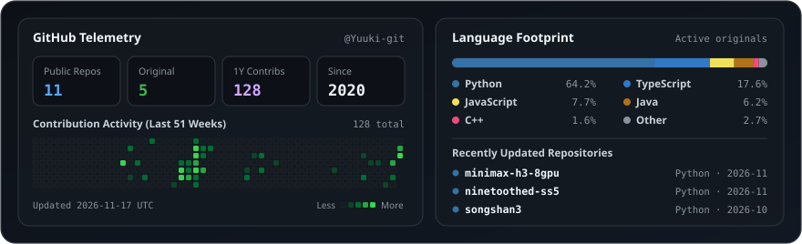

  <picture>
    <source media="(prefers-color-scheme: dark)" srcset="./assets/banner-dark.svg" />
    <source media="(prefers-color-scheme: light)" srcset="./assets/banner-light.svg" />
    
  </picture>

   

  **English** · [简体中文](./README.zh-CN.md) &nbsp;|&nbsp;
  [Repositories](https://github.com/Yuuki-git?tab=repositories) ·
  [Tech Stack](#-tech-stack) ·
  [Telemetry](#-github-telemetry)

---

### About Me

I am **Yuuki**, an M.S. student at **Zhengzhou University (ZZU)** working across **Multimodal AI Research** and **Backend / AI Systems Engineering**. I enjoy turning messy real-world problems into grounded architectures—whether that means optimizing multimodal inference kernels on heterogeneous GPUs or shipping traceable backend services and LLM agent pipelines.

---

### Tech Stack

| Layer | Technologies |
| :--- | :--- |
| **Languages** |      |
| **Backend & Systems** |       |
| **Multimodal & Agents** |       |
| **Frontend & Tooling** |     |

---

### GitHub Telemetry

  <picture>
    <source media="(prefers-color-scheme: dark)" srcset="./assets/stats-dark.svg" />
    <source media="(prefers-color-scheme: light)" srcset="./assets/stats-light.svg" />
    
  </picture>

  Auto-refreshed daily via <a href="./.github/workflows/update-profile.yml">GitHub Actions</a> · Zhengzhou University (ZZU)

