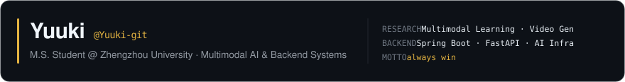
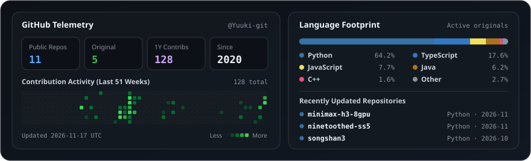

<picture>
  <source media="(prefers-color-scheme: dark)" srcset="./assets/banner-dark.svg" />
  <source media="(prefers-color-scheme: light)" srcset="./assets/banner-light.svg" />
  
</picture>

  <a href="./README.md">English</a> · <strong>简体中文</strong>

**郑州大学（ZZU）** 在读硕士研究生，研究方向为 **多模态人工智能（Multimodal AI）**，同时从事 **后端开发与 AI 基础设施工程**。专注于将想法落地为可复现的算子优化、可溯源的 RAG 服务与状态化 Agent 工作流。

### 代表项目

| 项目 | 核心内容 | 技术栈 |
| :--- | :--- | :--- |
| **[Smart-Knowledge-Hub](https://github.com/Yuuki-git/Smart-Knowledge-Hub)** | 面向代码与架构文档的混合检索 RAG 助手（`BM25 + Chroma + RRF`、引用溯源、SSE） | `Java 17` · `Spring Boot 3` · `Spring AI` · `WebFlux` · `Vue 3` |
| **[EasyPlan](https://github.com/Yuuki-git/EasyPlan)** | 意图驱动的 AI 规划 Agent（`意图画像 → 策略路由 → 规划 → 校验`、阶段推进） | `Python` · `FastAPI` · `LangGraph` · `React` · `TypeScript` |
| **[minimax-h3-8gpu](https://github.com/Yuuki-git/minimax-h3-8gpu)** | 8 卡海光 `gfx936` 环境下的 MiniMax-H3 FL2VA 多模态视频生成推理优化 | `Python` · `C++` · `NineToothed` · `InfiniCore / LM` |
| **[songshan3](https://github.com/Yuuki-git/songshan3)** & **[ninetoothed-ss5](https://github.com/Yuuki-git/ninetoothed-ss5)** | 核心算子融合（`二维/三维 RMSNorm`、`AdaLN + 门控残差`）与 `gfx936` AOT 编译补丁 | `Python` · `C++` · `HIP / Triton` |

### 技术栈

- **后端与数据：** `Java` · `Spring Boot 3` · `WebFlux` · `Python` · `FastAPI` · `PostgreSQL` · `Redis` · `OpenSearch` · `Docker`
- **多模态与系统：** `PyTorch` · `LangGraph` · `Spring AI` · `Chroma` · `NineToothed` · `Triton / HIP` · `TypeScript` · `C++`

<picture>
  <source media="(prefers-color-scheme: dark)" srcset="./assets/stats-dark.svg" />
  <source media="(prefers-color-scheme: light)" srcset="./assets/stats-light.svg" />
  
</picture>
